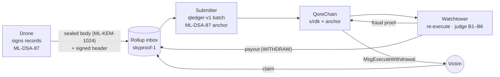

# SkyProof Rollup

**A post-quantum flight-record rollup for autonomous drones, live on QoreChain testnet.**

QoreChain *Build Before Q-Day* · category **Protocol Builders** · rollup [`skyproof-1`](https://api-testnet.qore.host/qorechain/rdk/v1/rollup/skyproof-1) on `qorechain-diana`

## The problem

When an autonomous drone hurts someone, the only flight log belongs to the operator. It can be edited, lost or withheld, and once a quantum computer can forge ECDSA, a classical signature on it proves nothing.

## What SkyProof does



1. **Fly.** The drone hash-chains every record and signs each 15 s segment's head with **ML-DSA-87**.
2. **Seal.** The segment's records are sealed with **ML-KEM-1024** to the investigator's and insurer's keys (registered on chain) and posted to the rollup inbox. A public header, signed by the drone, commits to the sealed body.
3. **Settle.** The submitter executes the inbox with **qledger-v1** and submits a batch, **anchored under the creator's ML-DSA-87 signature** in the same transaction.
4. **Watch.** The watchtower re-executes every batch, **challenges a wrong root with a fraud proof**, opens claimed flights and judges them against six rules.
5. **Pay.** A breach pays the victim from the claims pool (the operator's bond) as a **qledger withdrawal**, executed on QoreChain once the batch is final.

## Protocol Builders requirements

| Requirement | How | Proof |
|---|---|---|
| ML-DSA-signed batches | Creator's ML-DSA-87 `anchor_signature` on every `MsgSubmitBatch` | batch txs in [DEPLOYMENTS](docs/DEPLOYMENTS.md) |
| Verified settlement receipt | `verifySettlementReceipt` against live chain state: 6/6 checks | [`rollup/receipts/`](rollup/receipts) · website, Proof page, "Verify" |
| Watchtower | Re-execution + qledger fraud proofs + flight judging | [`rollup/src/watchtower.ts`](rollup/src/watchtower.ts), [`ledger.ts`](rollup/src/ledger.ts) |
| Withdrawal | Payouts and bond exits as qledger `WITHDRAW` → `MsgExecuteWithdrawal` | 5 QOR paid to a victim on testnet: tx `2C6A0DDB…` ([DEPLOYMENTS](docs/DEPLOYMENTS.md)) |
| ML-KEM data protection | Segments sealed to registered ML-KEM-1024 keys; the chain only stores ciphertext | [`rollup/src/flight/segment.ts`](rollup/src/flight/segment.ts) |
| Threat model | Assets, actors, threats, trust assumptions, limits | [docs/THREAT_MODEL.md](docs/THREAT_MODEL.md) |

## The six rules

| Rule | Breach when |
|---|---|
| B1 Geofence | left the permitted area or entered a no-fly zone |
| B2 Altitude | flew above the permit's ceiling |
| B3 Unapproved action | took off / dropped / landed without a fresh, matching, single-use safety approval |
| B4 Override | acted after the safety model said DENY |
| B5 Record broken | a segment edited, missing, withheld, unsigned, or the flight never closed |
| B6 Wind | took off in wind above the permit's limit |

## Repository

| Folder | What |
|---|---|
| [`rollup/`](rollup) | TypeScript: records, sealing, rules, ledger, watchtower, CLI for every step |
| [`web/`](web) | Website with five pages: **Home** (3D demo of all eight scenarios, judged in the browser by the same rules code), **Flights** (ML-DSA-87 checks and a tamper test), **Claims** (look up your claims and balance), **Proof** (live receipt verification, payouts, upheld fraud proofs), **Investigate** (ML-KEM-1024 decryption and 3D replay of on-chain flights) |
| [`docs/`](docs) | [Design](docs/DESIGN.md), [threat model](docs/THREAT_MODEL.md), [deployments](docs/DEPLOYMENTS.md) |

## Run it

Needs Node 22+. Tests and the dry run need no wallet and spend nothing:

```sh
cd rollup
npm install
npm test           # 29 tests
npm run dry-run    # every scenario end to end, offline
```

On testnet (a funded test wallet's recovery phrase in `rollup/.env`, see `.env.example`):

```sh
npm run preflight                 # read-only: costs, balance, ML-DSA key
npm run setup                     # role accounts, ML-DSA + ML-KEM keys
npm run create-rollup             # skyproof-1 + submitter bond
npm run deposit -- 50             # operator bond into the claims pool
npm run fly -- override           # normal | geofence | altitude | override | unapproved | wind  [--withhold]
npm run claim -- <flight id>
npm run batch                     # settle (anchored, ML-DSA-87)
npm run watch                     # re-execute, judge, pay out
npm run batch                     # settle the payout
npm run withdraw                  # after the challenge window
npm run receipt -- <batch>        # verify the settlement receipt
```

Website: `cd web && npm install && npm run dev` (data from `npm run export-web` in `rollup/`).

Deploy the website, either way:

- **Azure Static Web Apps.** Create a Static Web App (Free plan, deployment source "Other"). Copy its deployment token into the repository secret `AZURE_STATIC_WEB_APPS_API_TOKEN`. Every push to `main` then runs [`.github/workflows/azure-static-web-apps.yml`](.github/workflows/azure-static-web-apps.yml), which builds `web/` and deploys it with the read-only QoreChain proxy in [`azure/api/`](azure/api/index.js).
- **Vercel.** Run `npx vercel` from the **repository root** (the page shares code with `rollup/`). `vercel.json` builds `web/` and serves the same proxy from [`api/proxy.ts`](api/proxy.ts).

## Credits

- [`@qorechain/rdk`](https://github.com/qorechain/qorechain-rdk) (Apache-2.0): rollup client, qledger-v1, envelopes, settlement receipts.
- [`@qorechain/sdk`](https://github.com/qorechain/qorechain-sdk): accounts and hybrid ML-DSA-87 signing.
- [`@noble/hashes`](https://github.com/paulmillr/noble-hashes) (MIT), [Vite](https://vitejs.dev) (MIT).

The idea (a tamper-evident drone black box with automatic payouts) was first prototyped by our team at ETHGlobal Mumbai on other chains. This repository is a new build for QoreChain, written during the fest. How AI was used: [AI_USAGE.md](AI_USAGE.md).

## License

[Apache-2.0](LICENSE)
