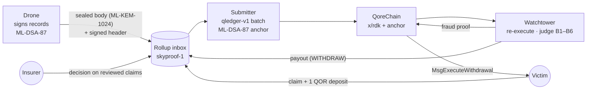

# SkyProof Rollup

**A post-quantum flight-record rollup for autonomous drones, live on QoreChain testnet.**

QoreChain *Build Before Q-Day* · category **Protocol Builders** · rollup [`skyproof-1`](https://api-testnet.qore.host/qorechain/rdk/v1/rollup/skyproof-1) on `qorechain-diana`

[](https://github.com/ponram06/skyproof-qorex/actions/workflows/test.yml)

## For judges: verify it in 3 minutes

**Live site: https://skyproof-qorex.malaysiawest.cloudapp.azure.com** (no wallet or install needed)

1. **Watch it (30 s).** Home → *Try it* → **Operator ignores "No"**: the drone drops on a person after its safety check said No. Then **Too windy**: a gust blows the parcel onto a car.
2. **Follow one real flight (60 s).** **Guided demo**: one flight from take-off to payout. Every *Check* button asks QoreChain live from your browser.
3. **Open a sealed record (30 s).** *Check the proof* → **Investigate**, demo code **`skyproof-demo`**. A wrong code leaves it sealed (ML-KEM-1024).
4. **Be the insurer (30 s).** **Insurers**, demo code **`skyproof-demo`**: check a real and a fake photo against the fingerprint on chain, open the record, approve or reject. In demo mode the decision is shown, not posted.
5. **Check the chain (30 s).** [EVIDENCE.md](docs/EVIDENCE.md): every step from rollup creation to payout and the upheld fraud proof, one click each. [ATTACKS.md](docs/ATTACKS.md): 19 attacks refused, each with a test or a transaction.

| | |
|---|---|
| Testnet transactions | [EVIDENCE.md](docs/EVIDENCE.md) (short) · [DEPLOYMENTS.md](docs/DEPLOYMENTS.md) (everything) |
| Settlement receipts | all 12 batches: `cd rollup && npm run receipt -- all` (saved in [`rollup/receipts/`](rollup/receipts), still checkable after QoreChain prunes old batches: add `--saved`) |
| Tests | 56, run in CI on every push: `cd rollup && npm test` |
| Payout audit | 5 of 5 payouts justified: `cd rollup && npm run audit` |
| Known limits | [THREAT_MODEL.md](docs/THREAT_MODEL.md#known-limits-stated-plainly) |

## The problem

When an autonomous drone hurts someone, the only flight log belongs to the operator. It can be edited, lost or withheld, and once a quantum computer can forge ECDSA, a classical signature on it proves nothing.

## What SkyProof does



1. **Fly.** The drone hash-chains every record and signs each 15 s segment's head with **ML-DSA-87**.
2. **Seal.** The segment's records are sealed with **ML-KEM-1024** to the investigator's and insurer's keys (registered on chain) and posted to the rollup inbox. A public header, signed by the drone, commits to the sealed body.
3. **Settle.** The submitter executes the inbox with **qledger-v1** and submits a batch, **anchored under the creator's ML-DSA-87 signature** in the same transaction.
4. **Watch.** The watchtower re-executes every batch, **challenges a wrong root with a fraud proof**, opens claimed flights and judges them against six rules.
5. **Claim.** A victim files a claim from the website. They name the drone (its painted ID or Remote ID broadcast) and the time, and the page finds the flight that was in the air then. A flight the operator never published can still be claimed: if no record appears within ~30 minutes, the claim goes to the insurer marked "no record". The claim holds what happened, when, where, a photo fingerprint (SHA-256; the photo stays on their phone) and a **1 QOR refundable deposit**, all in one hybrid-signed transaction from a quantum-safe wallet the page creates in the browser.
6. **Pay or review.** A breach pays the victim **5 QOR plus their deposit back** from the claims pool (the operator's bond) as a **qledger withdrawal**, executed on QoreChain once the batch is final. No breach sends the claim to the **insurer**, who checks the photo against its fingerprint, opens the sealed record and signs a decision: approved → paid the same way; rejected as false → nothing paid, deposit kept. Deposits make spam and false claims cost money.
7. **Audit.** Only the watchtower holds the pool key, and qledger has no multi-signature, so a separate program (`npm run audit`) rebuilds everything from the chain and matches every pool payout to a claim that was owed. On testnet: 5 of 5 justified. Known limits, stated plainly, are in the [threat model](docs/THREAT_MODEL.md#known-limits-stated-plainly).

## Why QoreChain

SkyProof needs records that stay trustworthy for years: an accident claim or a court case can come long after the flight. A classical signature on a flight log stops proving anything once quantum computers can forge it. QoreChain gives SkyProof, natively:

- **ML-DSA-87 on every account and every transaction** (hybrid with secp256k1): drones, the operator, victims and the insurer all sign quantum-safe, including from a browser.
- **ML-KEM-1024 keys registered on chain**: flight records are sealed to the investigator and insurer, so the chain holds the proof without exposing where people were.
- **x/rdk rollups with qledger-v1**: a rollup with its own ledger, fraud proofs, and withdrawals paid out on QoreChain, without writing a settlement contract.
- **Settlement receipts**: anyone can check that a batch was anchored under the creator's ML-DSA-87 signature.

On a chain with only ECDSA, every one of these would be either missing or classical.

## Protocol Builders requirements

| Requirement | How | Proof |
|---|---|---|
| ML-DSA-signed batches | Creator's ML-DSA-87 `anchor_signature` on every `MsgSubmitBatch` | batch txs in [DEPLOYMENTS](docs/DEPLOYMENTS.md) |
| Verified settlement receipt | `verifySettlementReceipt` against live chain state: 6/6 checks | [`rollup/receipts/`](rollup/receipts) · website, Proof page, "Verify" |
| Watchtower | Re-execution + qledger fraud proofs + flight judging | [`rollup/src/watchtower.ts`](rollup/src/watchtower.ts), [`ledger.ts`](rollup/src/ledger.ts) |
| Withdrawal | Payouts and bond exits as qledger `WITHDRAW` → `MsgExecuteWithdrawal` | 5 QOR paid to a victim on testnet: tx `2C6A0DDB…` ([DEPLOYMENTS](docs/DEPLOYMENTS.md)) |
| ML-KEM data protection | Segments sealed to registered ML-KEM-1024 keys; the chain only stores ciphertext | [`rollup/src/flight/segment.ts`](rollup/src/flight/segment.ts) |
| Threat model | Assets, actors, threats, trust assumptions, limits | [docs/THREAT_MODEL.md](docs/THREAT_MODEL.md) |

## The six rules

| Rule | Breach when |
|---|---|
| B1 Geofence | left the permitted area or entered a no-fly zone |
| B2 Altitude | flew above the permit's ceiling |
| B3 Unapproved action | took off / dropped / landed without a fresh, matching, single-use safety approval |
| B4 Override | acted after the safety model said DENY |
| B5 Record broken | a segment edited, missing, withheld, unsigned, or the flight never closed |
| B6 Wind | took off in wind above the permit's limit |

## Repository

| Folder | What |
|---|---|
| [`rollup/`](rollup) | TypeScript: records, sealing, rules, ledger, watchtower, CLI for every step |
| [`web/`](web) | Website (pages below) |
| [`docs/`](docs) | [Design](docs/DESIGN.md), [threat model](docs/THREAT_MODEL.md), [evidence](docs/EVIDENCE.md), [attacks](docs/ATTACKS.md), [deployments](docs/DEPLOYMENTS.md) |

## The website

| Page | For | What it does |
|---|---|---|
| **Demo** | Judges | One real flight end to end in seven steps, with live checks: each signed part matched byte for byte with QoreChain's copy, a tamper attempt, the claim, the verdict, the payout tx and the fraud-proof tx read from the chain |
| **Home** | Everyone | 3D demo of four situations (safe, waits for a person, person hit, car hit in wind), judged in the browser by the same rules code as the watchtower |
| **Flights** | Everyone | Real flights, their ML-DSA-87 signatures and a tamper test |
| **Claims** | Victims | File a claim from a quantum-safe browser wallet: name the drone and the time, and the page finds the flight that was in the air (or claim one the operator never published). Deposit, photo fingerprint, and a live lookup of your claims and balance |
| **Insurers** | Insurer | Claims sent to review: check the victim's photo, open the sealed record, approve or reject with a signed decision |
| **Operators** | Drone operators | Your drones, flight log, bond, claims against you and their cost, and the rollup inbox read live |
| **Proof** | Anyone | Live settlement-receipt verification, every payout (amount, recipient, batch), the independent payout audit, upheld fraud proofs |
| **Investigate** | Investigator | ML-KEM-1024 decryption and 3D replay of on-chain flights |

## Run it

Needs Node 22+. Tests and the dry run need no wallet and spend nothing:

```sh
cd rollup
npm install
npm test           # 56 tests
npm run dry-run    # every scenario end to end, offline
```

On testnet (a funded test wallet's recovery phrase in `rollup/.env`, see `.env.example`):

```sh
npm run preflight                 # read-only: costs, balance, ML-DSA key
npm run setup                     # role accounts, ML-DSA + ML-KEM keys
npm run create-rollup             # skyproof-1 + submitter bond
npm run deposit -- 50             # operator bond into the claims pool
npm run fly -- cheating           # normal | people_below | link_lost | cheating | unapproved | shortcut | altitude | wind  [--withhold]
npm run claim -- <flight id>      # or file it from the website's Claims page
npm run insurer-key               # the insurer's key file for the Insurers page
npm run batch                     # settle (anchored, ML-DSA-87)
npm run watch                     # re-execute, judge, pay out (--loop to keep watching)
npm run audit                     # independently re-derive what was owed and match every pool payout
npm run batch                     # settle the payout
npm run withdraw                  # after the challenge window
npm run receipt -- <batch>        # verify the settlement receipt (or: all; add --saved for pruned batches)
```

Website: `cd web && npm install && npm run dev` (data from `npm run export-web` in `rollup/`).

Deploy the website, either way:

- **Azure Static Web Apps.** Create a Static Web App (Free plan, deployment source "Other"). Copy its deployment token into the repository secret `AZURE_STATIC_WEB_APPS_API_TOKEN`. Every push to `main` then runs [`.github/workflows/azure-static-web-apps.yml`](.github/workflows/azure-static-web-apps.yml), which builds `web/` and deploys it with the read-only QoreChain proxy in [`azure/api/`](azure/api/index.js).
- **Vercel.** Run `npx vercel` from the **repository root** (the page shares code with `rollup/`). `vercel.json` builds `web/` and serves the same proxy from [`api/proxy.ts`](api/proxy.ts).

## Credits

- [`@qorechain/rdk`](https://github.com/qorechain/qorechain-rdk) (Apache-2.0): rollup client, qledger-v1, envelopes, settlement receipts.
- [`@qorechain/sdk`](https://github.com/qorechain/qorechain-sdk): accounts and hybrid ML-DSA-87 signing.
- [`@noble/hashes`](https://github.com/paulmillr/noble-hashes) (MIT), [`@cosmjs/stargate`](https://github.com/cosmos/cosmjs) (Apache-2.0), [`dotenv`](https://github.com/motdotla/dotenv) (BSD-2-Clause).
- Website: [Vite](https://vitejs.dev) (MIT), [three.js](https://threejs.org) (MIT) for the 3D demo, [Leaflet](https://leafletjs.com) (BSD-2-Clause) with map data © [OpenStreetMap](https://www.openstreetmap.org/copyright) contributors (ODbL).
- QoreX logo on the 3D drone: QoreChain's, used to mark the hackathon entry.
- Hosting: an Azure VM with nginx and a Let's Encrypt certificate.

The idea (a tamper-evident drone black box with automatic payouts) was first prototyped by our team at ETHGlobal Mumbai on other chains. This repository is a new build for QoreChain, written during the fest. How AI was used: [AI_USAGE.md](AI_USAGE.md).

## License

[Apache-2.0](LICENSE)
